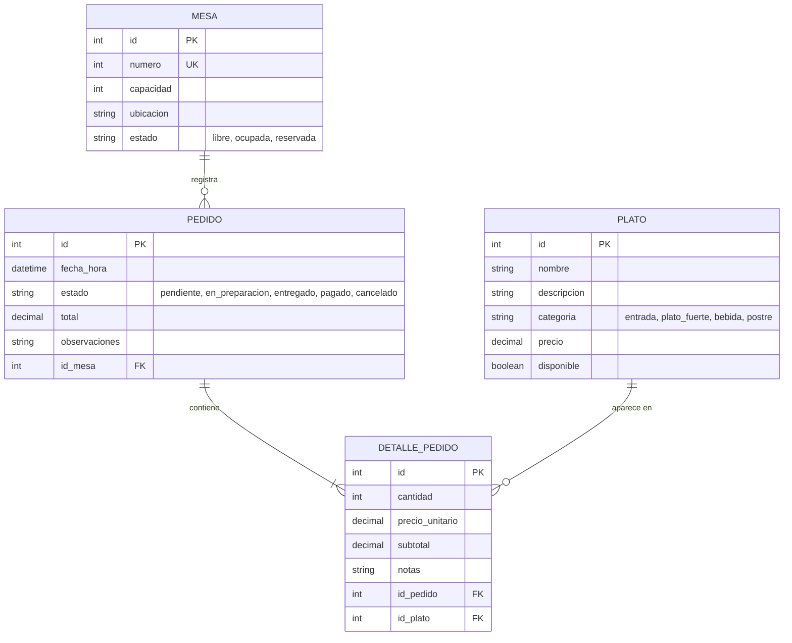

# 🚀 RestAdmin API

## 📖 Descripción del Proyecto

RestAdmin API es una API REST diseñada para digitalizar la operación diaria del salón de un restaurante. Permite administrar las mesas, mantener actualizado el menú de platos y registrar los pedidos que hace cada mesa, con el detalle de qué platos se pidieron, en qué cantidad y a qué precio.

Está pensada para meseros, personal de cocina y administradores del restaurante. Resuelve un problema común en restaurantes pequeños y medianos: las comandas en papel se pierden, se escriben con letra ilegible o llegan tarde a la cocina, y al final del día no hay un registro confiable de cuánto se vendió ni qué platos salieron más. Con RestAdmin cada pedido queda asociado a una mesa, la cocina consulta en tiempo real los pedidos pendientes y el total de la cuenta se calcula automáticamente.

El diseño guarda el precio de cada plato en el momento en que se pide. Así, si el menú cambia de precio, los pedidos ya registrados conservan el valor que realmente se cobró, lo que mantiene la información histórica de ventas consistente.

## 🎥 Video de Presentación
* 🎬 **Enlace al video de presentación (Máx. 5 minutos):** [Haz clic aquí para ver el video](https://enlace-a-tu-video.com)

## 👥 Equipo de Desarrollo
| Nombre | Rol | GitHub |
|--------|-----|--------|
| Yeison Alejandro Zapata Gómez | Líder / Arquitecto Backend | [@Yazapatago](https://github.com/Yazapatago) |
| Luis Alejandro Londoño Valle | Analista de Datos | [@AlejandroLondonoValle](https://github.com/AlejandroLondonoValle) |
| Juan Esteban Isaza Gómez | Diseñador de API | [@JuanEstebanIG](https://github.com/JuanEstebanIG) |
| Jair Alvares | QA | [@jairalvarez099-byte](https://github.com/jairalvarez099-byte) |
## 🏗️ Modelo de Datos (Entidades)
El sistema se compone de las siguientes 4 entidades principales y sus relaciones:
1. **Mesa**: Espacio físico del restaurante donde se atiende a los clientes. Tiene un número, una capacidad y un estado (libre, ocupada o reservada).
2. **Plato**: Producto del menú que se puede pedir. Incluye nombre, descripción, categoría (entrada, plato fuerte, bebida o postre), precio y disponibilidad.
3. **Pedido**: Comanda registrada para una mesa. Guarda la fecha y hora, el estado (pendiente, en preparación, entregado, pagado o cancelado) y el total a cobrar.
4. **DetallePedido**: Línea de un pedido. Indica qué plato se pidió, la cantidad, el precio unitario cobrado y notas para la cocina (por ejemplo, "sin cebolla").

**Relaciones:**
* **Mesa → Pedido (1:N):** una mesa puede registrar muchos pedidos a lo largo del día; cada pedido pertenece a una sola mesa.
* **Pedido → DetallePedido (1:N):** un pedido contiene uno o varios detalles; cada detalle pertenece a un solo pedido.
* **Plato → DetallePedido (1:N):** un plato puede aparecer en muchos detalles; cada detalle hace referencia a un solo plato.
* **Pedido ↔ Plato (N:M):** un pedido tiene muchos platos y un plato aparece en muchos pedidos. Esta relación se resuelve mediante **DetallePedido**, que además guarda la cantidad y el precio del momento.

### Diagrama Entidad-Relación

## 🔌 Documentación de Endpoints (API Design)
A continuación se detallan los endpoints diseñados bajo estándares RESTful: sustantivos en plural, kebab-case, métodos HTTP según la acción y versionado en la URL.
Base URL propuesta: `http://api.restadmin.com/api/v1`

### 1. Recurso: Mesas (`/tables`)

| Método | Endpoint | Descripción | Payload (Body) | Respuesta Esperada |
|--------|----------|-------------|----------------|--------------------|
| GET | `/tables` | Listar todas las mesas (filtro opcional `?estado=libre`) | N/A | 200 OK (Array) |
| GET | `/tables/{id}` | Obtener una mesa | N/A | 200 OK (Object) / 404 Not Found |
| POST | `/tables` | Crear una mesa | `{ "numero": 5, "capacidad": 4, "ubicacion": "terraza" }` | 201 Created |
| PUT | `/tables/{id}` | Actualizar todos los datos de una mesa | `{ "numero": 5, "capacidad": 6, "ubicacion": "salón", "estado": "libre" }` | 200 OK |
| PATCH | `/tables/{id}` | Cambiar el estado de una mesa | `{ "estado": "ocupada" }` | 200 OK |
| DELETE | `/tables/{id}` | Eliminar una mesa | N/A | 204 No Content |

### 2. Recurso: Platos (`/dishes`)

| Método | Endpoint | Descripción | Payload (Body) | Respuesta Esperada |
|--------|----------|-------------|----------------|--------------------|
| GET | `/dishes` | Listar el menú (filtros opcionales `?categoria=bebida&disponible=true`) | N/A | 200 OK (Array) |
| GET | `/dishes/{id}` | Obtener un plato | N/A | 200 OK (Object) / 404 Not Found |
| POST | `/dishes` | Agregar un plato al menú | `{ "nombre": "Bandeja paisa", "descripcion": "Frijoles, arroz, chicharrón...", "categoria": "plato_fuerte", "precio": 32000, "disponible": true }` | 201 Created |
| PUT | `/dishes/{id}` | Actualizar todos los datos de un plato | `{ "nombre": "Bandeja paisa", "descripcion": "...", "categoria": "plato_fuerte", "precio": 34000, "disponible": true }` | 200 OK |
| PATCH | `/dishes/{id}` | Marcar un plato como agotado | `{ "disponible": false }` | 200 OK |
| DELETE | `/dishes/{id}` | Eliminar un plato del menú | N/A | 204 No Content |

### 3. Recurso: Pedidos (`/orders`)

| Método | Endpoint | Descripción | Payload (Body) | Respuesta Esperada |
|--------|----------|-------------|----------------|--------------------|
| GET | `/orders` | Listar pedidos (filtro opcional `?estado=pendiente` para la cocina) | N/A | 200 OK (Array) |
| GET | `/orders/{id}` | Obtener un pedido con sus detalles y total | N/A | 200 OK (Object) / 404 Not Found |
| POST | `/orders` | Crear un pedido asociado a una mesa con sus platos | `{ "id_mesa": 3, "observaciones": "Cliente con prisa", "items": [ { "id_plato": 7, "cantidad": 2 }, { "id_plato": 12, "cantidad": 1, "notas": "sin hielo" } ] }` | 201 Created |
| PUT | `/orders/{id}` | Actualizar los datos generales de un pedido | `{ "id_mesa": 4, "observaciones": "Cambio de mesa" }` | 200 OK |
| PATCH | `/orders/{id}` | Cambiar el estado del pedido | `{ "estado": "entregado" }` | 200 OK |
| DELETE | `/orders/{id}` | Eliminar un pedido (solo si está en estado pendiente) | N/A | 204 No Content |

### 4. Recurso: Detalles de Pedido (`/order-items`)

| Método | Endpoint | Descripción | Payload (Body) | Respuesta Esperada |
|--------|----------|-------------|----------------|--------------------|
| GET | `/order-items` | Listar todos los detalles (filtro opcional `?id_plato=7` para ver ventas de un plato) | N/A | 200 OK (Array) |
| GET | `/order-items/{id}` | Obtener un detalle | N/A | 200 OK (Object) / 404 Not Found |
| PUT | `/order-items/{id}` | Actualizar un detalle completo | `{ "id_plato": 7, "cantidad": 3, "notas": "término medio" }` | 200 OK |
| PATCH | `/order-items/{id}` | Cambiar la cantidad de un detalle | `{ "cantidad": 3 }` | 200 OK |
| DELETE | `/order-items/{id}` | Eliminar un detalle | N/A | 204 No Content |

> Los detalles se crean siempre dentro de un pedido (ver `POST /orders/{id}/items` en la sección de relaciones), porque un detalle no puede existir sin el pedido al que pertenece. El `precio_unitario` no se envía en el body: la API lo copia del precio actual del plato y calcula el `subtotal` y el `total` del pedido.

### 5. Endpoints de Relación (Anidados)
*Endpoints que cruzan entidades.*

| Método | Endpoint | Descripción | Payload (Body) | Respuesta Esperada |
|--------|----------|-------------|----------------|--------------------|
| GET | `/tables/{id}/orders` | Obtener todos los pedidos de una mesa (filtro opcional `?estado=pendiente`) | N/A | 200 OK (Array) |
| GET | `/orders/{id}/items` | Obtener los platos de un pedido | N/A | 200 OK (Array) |
| POST | `/orders/{id}/items` | Agregar un plato a un pedido existente | `{ "id_plato": 7, "cantidad": 2, "notas": "término medio" }` | 201 Created |
| DELETE | `/orders/{id}/items/{item_id}` | Quitar un plato de un pedido | N/A | 204 No Content |

## 🛠️ Stack Tecnológico Propuesto
*   **Lenguaje:** Python
*   **Framework:** FastAPI
*   **Base de Datos:** PostgreSQL
*   **Autenticación:** JWT

## 📅 Roadmap / Próximos Pasos
1. Configurar el entorno de desarrollo.
2. Crear las migraciones de base de datos basadas en el diagrama ER (Mesa, Plato, Pedido, DetallePedido).
3. Implementar los controladores para los endpoints GET.
4. Implementar los endpoints POST, PUT, PATCH y DELETE, incluyendo el cálculo automático de subtotales y totales.
5. Implementar los endpoints anidados de relación.

## 🔗 Enlaces
*   **Repositorio GitHub:** [https://github.com/Yazapatago/api-design-restadmin](https://github.com/Yazapatago/api-design-restadmin)
*   **Video de Presentación:** [https://enlace-a-tu-video.com](https://youtu.be/kMXvWcDmOhc)
*   **Organización del equipo:** No aplica

---
**⚠️ Nota:** Este repositorio contiene solo la documentación y diseño. No incluye código fuente de la aplicación.
